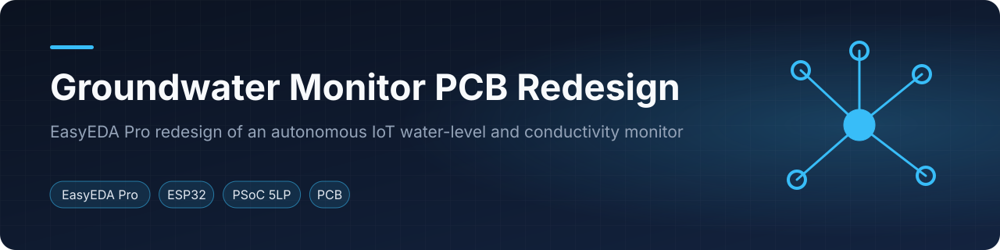
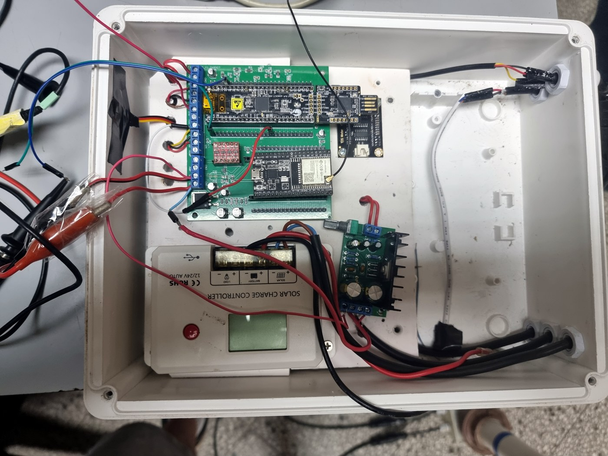
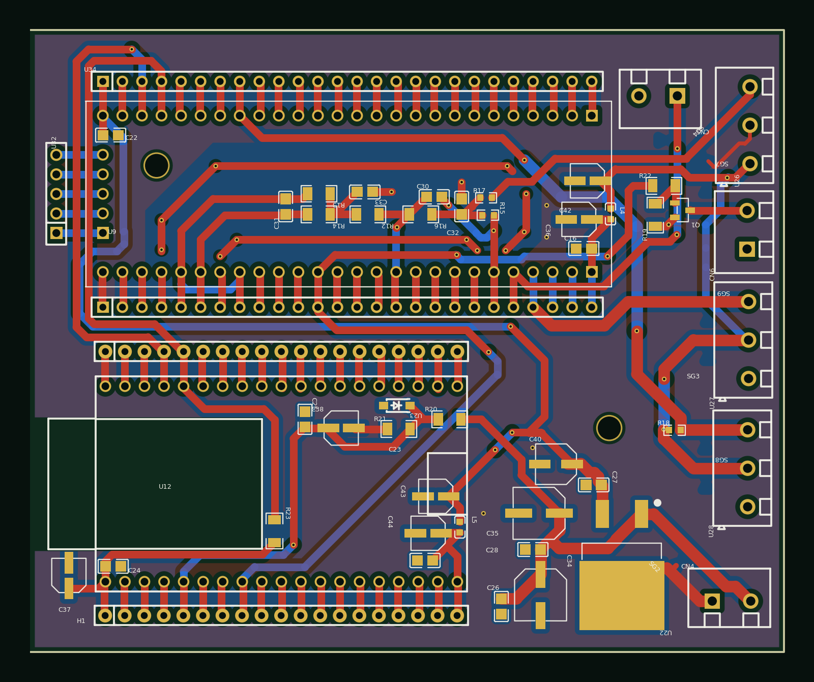
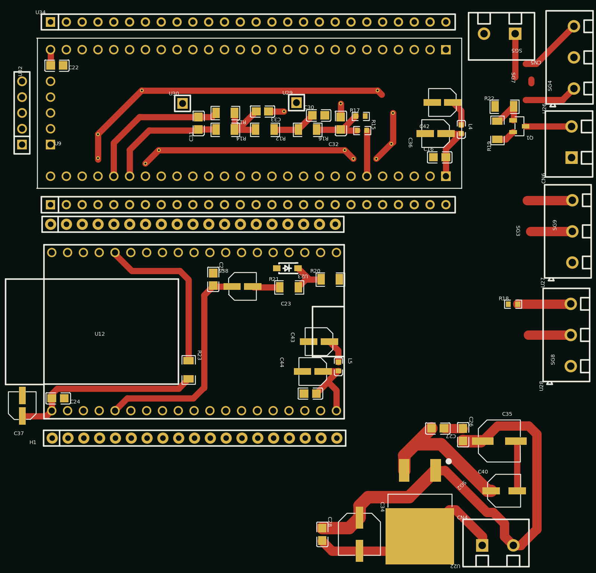
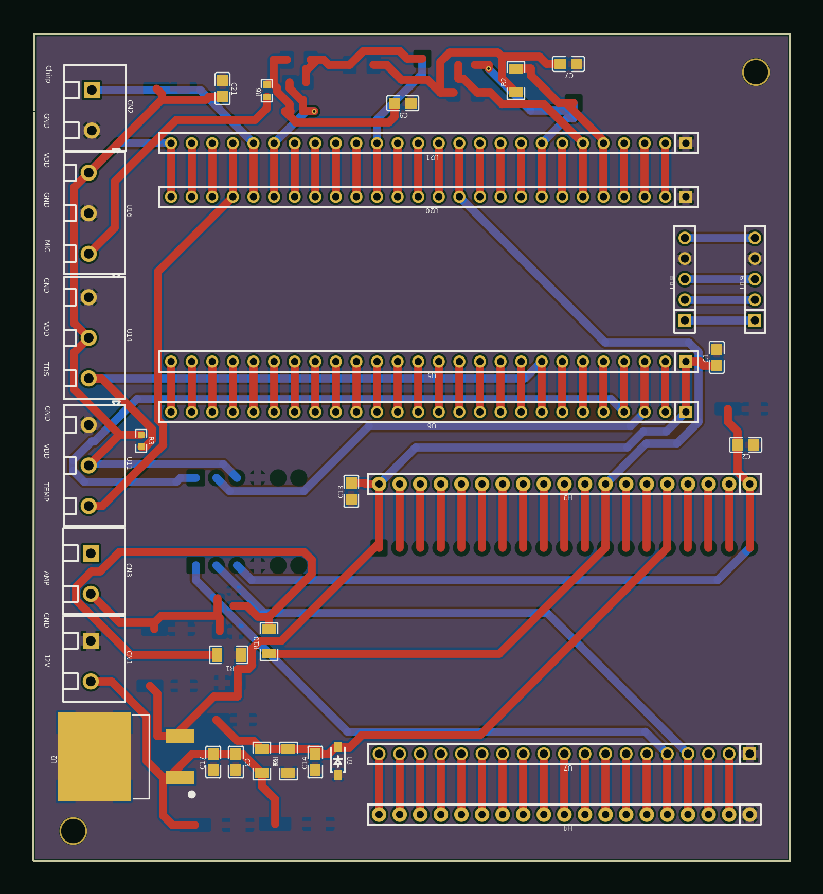
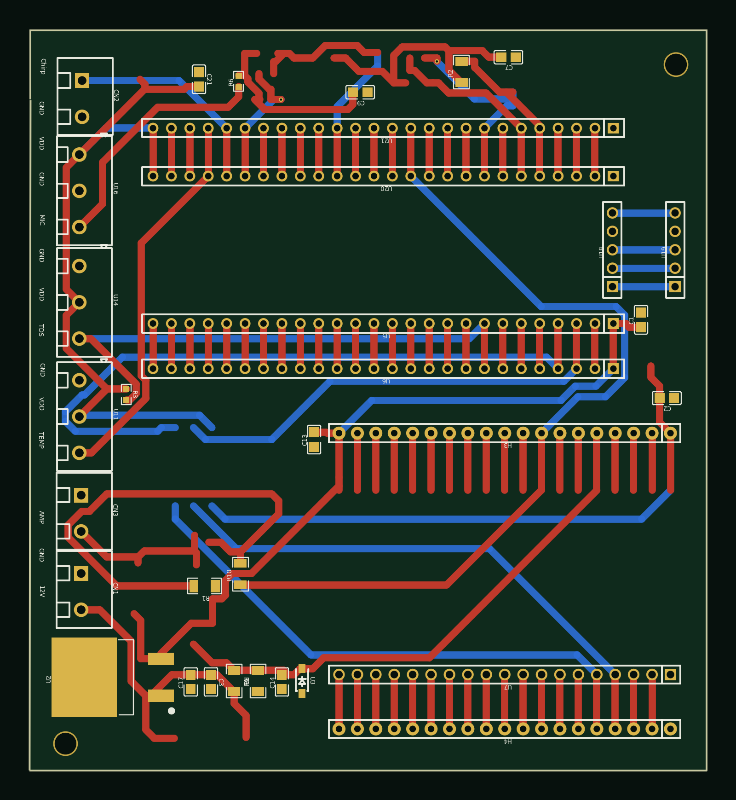

<p align="center"></p>

<p align="center">     </p>
<p align="center"><a href="#english">English</a> · <a href="#español">Español</a></p>

## English

### Overview
PCB redesign of an autonomous IoT groundwater-level and water-conductivity monitor developed by **Nicolás Escurra** (advisor: **Enrique A. Vargas Cabral, PhD**, FCT – Universidad Católica "Nuestra Señora de la Asunción"). **Elías's contribution** is the redesigned carrier/main boards in EasyEDA Pro, done at the advisor's request. The monitor itself (its firmware and measurement method) is not part of this repository.

<p align="center"><br><sub>Field enclosure of the monitor (2025)</sub></p>

### What the board connects
Taken from the parts and net names of the EasyEDA schematic (`Medidor_de_Nivel_SMD`):

| Item | Role on the board |
|------|-------------------|
| ESP32-DevKitC | Mounted on the carrier headers |
| CY8CKIT-059 (PSoC 5LP) | Mounted on the carrier headers |
| LM7805D2TRG | 5 V regulator fed from the 12 V input |
| Bidirectional level converter | Interface between the 3.3 V and 5 V domains |
| `TDS_DATA` | Input for the TDS (conductivity) sensor module |
| `DS18B20_DATA` | Input for the DS18B20 temperature sensor |
| `BAT_LEVEL` | Battery-level sense line |
| `PIN_WAKEUP` | Wake-up line |
| Screw terminals and headers | Field wiring (12 V, GND, sensor and signal connectors) |

### PCB renders
Previews generated from the EasyEDA Pro `.epcb` files with a small Python renderer: board outline, top (red) and bottom (blue) copper, vias, pads, copper pours and top silkscreen. They are not CAM-accurate Gerber output.

<table><tr>
<td align="center" width="50%"><br><sub><b>ELIAS</b>: routed two-layer board with top and bottom ground pours</sub></td>
<td align="center" width="50%"><br><sub><b>ELIAS_1</b>: partially routed variant (top-copper tracks only, no board outline in the file)</sub></td>
</tr><tr>
<td align="center" width="50%"><br><sub><b>NICO_</b>: routed layout with ground pour</sub></td>
<td align="center" width="50%"><br><sub><b>NICO_SIN_PLANO_DE_TIERRA</b>: same routing as NICO_, without the ground pour</sub></td>
</tr></table>

The project files do not record which layout came first, so the boards are captioned by their names in the file.

### Repository layout
```
hardware/
  easyeda/water-monitor.epro   EasyEDA Pro project (3 schematics, 6 PCB documents)
  pcb/                         Rendered board previews and board list
docs/img/                      Banner, field-enclosure photo and assembly photos
```
Open `hardware/easyeda/water-monitor.epro` with EasyEDA Pro to inspect the schematics and boards.

### Field photos
<table><tr>

</tr></table>

### Credits
- **Groundwater monitor** (concept, firmware and measurement method): developed by **Nicolás Escurra**, advised by **Enrique A. Vargas Cabral, PhD** (FCT – Universidad Católica "Nuestra Señora de la Asunción").
- **PCB redesign** (carrier/main boards in EasyEDA Pro): **Elías Álvarez**, at the advisor's request. Elías did not work on the monitor's code.

### License
MIT, see [LICENSE](LICENSE).

---

## Español

### Descripción general
Rediseño de PCB de un monitor IoT autónomo de nivel freático y conductividad del agua, desarrollado por **Nicolás Escurra** (tutor: **Enrique A. Vargas Cabral, PhD**, FCT – Universidad Católica "Nuestra Señora de la Asunción"). **La contribución de Elías** son las placas portadora/principal rediseñadas en EasyEDA Pro, realizadas a pedido del tutor. El monitor en sí (su firmware y método de medición) no forma parte de este repositorio.

### Qué conecta la placa
Según las piezas y los nombres de red del esquemático de EasyEDA (`Medidor_de_Nivel_SMD`): ESP32-DevKitC y CY8CKIT-059 (PSoC 5LP) montados sobre los cabezales de la placa, regulador LM7805 desde la entrada de 12 V, conversor bidireccional de niveles lógicos (3,3 V / 5 V), entradas `TDS_DATA` (sensor TDS) y `DS18B20_DATA` (temperatura), líneas `BAT_LEVEL` (nivel de batería) y `PIN_WAKEUP` (despertar), y bornes y cabezales para el cableado de campo.

### Renders de PCB
Ver la tabla en la sección en inglés: ELIAS (placa ruteada con planos de masa superior e inferior), ELIAS_1 (variante parcialmente ruteada), NICO_ (layout ruteado con plano de masa) y NICO_SIN_PLANO_DE_TIERRA (mismo ruteo sin plano de masa). El proyecto no registra cuál layout fue el primero. Las imágenes son vistas previas, no salida Gerber.

### Estructura
- `hardware/easyeda/water-monitor.epro`: proyecto de EasyEDA Pro (3 esquemáticos, 6 documentos PCB).
- `hardware/pcb/`: vistas previas de las placas.

### Créditos
- **Monitor de aguas subterráneas** (concepto, firmware y método de medición): desarrollado por **Nicolás Escurra**, tutorizado por **Enrique A. Vargas Cabral, PhD** (FCT – Universidad Católica "Nuestra Señora de la Asunción").
- **Rediseño de PCB** (placas portadora/principal en EasyEDA Pro): **Elías Álvarez**, a pedido del tutor. Elías no trabajó en el código del monitor.

### Licencia
MIT, ver [LICENSE](LICENSE).
